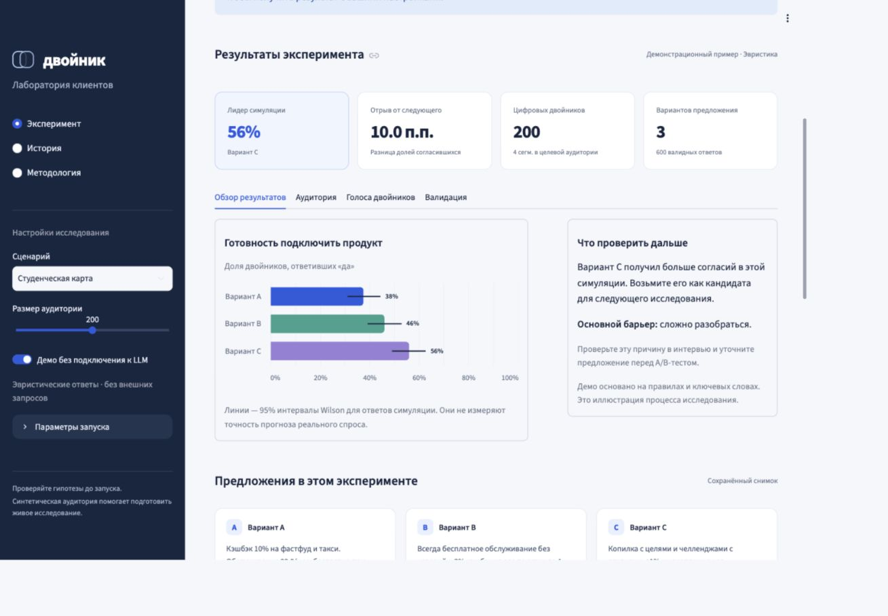

# Двойник

Лаборатория синтетических клиентов для продуктовых команд, маркетинга и UX-исследователей банка.
Сравните предложения на одной аудитории, найдите барьеры по сегментам и проверьте результат на живом опросе до пилота.

**MISIS X** · Академия Финтеха 2026, трек «Финтех без границ» (ВТБ)

Никита Мещеряков — ML/LLM · Юлия Соколова — Product Manager



## Быстрый запуск

Python 3.11 или 3.12:

```bash
python3 -m venv .venv
source .venv/bin/activate
pip install -r requirements.txt
streamlit run app.py
```

Откройте `http://localhost:8501`. По умолчанию включено демо без внешних запросов.
При первом открытии показывается **демонстрационный отчёт**, который не записывается в историю.
Настройте предложения и аудиторию, затем нажмите **«Запустить эксперимент»**.

## Рабочий процесс

1. Создайте собственный сценарий или выберите один из семи шаблонов: студенческая карта, семейный счёт, кредитная карта,
   вклад 60+, пуш о кэшбэке, тариф самозанятых или переводы нерезидентов.
2. Измените вопрос, тексты предложений и доли целевых сегментов. В собственном сценарии доступны
   2–5 вариантов, любой из семи сегментов, контекст исследования и свои категории отказа.
   Контекст передаётся LLM вместе с вопросом и предложением. Выберите 50–1000 двойников.
3. Запустите эксперимент в демо или LLM-режиме. Все варианты оценивают одни и те же профили.
4. Сравните готовность подключить продукт, результаты сегментов, число ответов и причины отказа.
   При одинаковой конверсии приложение показывает ничью.
5. Посмотрите примеры профилей и синтетических объяснений. Отфильтруйте согласия и отказы.
6. Загрузите живой опрос на вкладке «Валидация», нажмите «Сохранить проверку в эксперименте»
   и скачайте отчёты JSON/CSV. Проверка сохраняется вместе с результатами.

История сохраняет до 20 запусков **в текущей сессии браузера**. Она не является постоянным хранилищем:
при потере сессии или перезапуске сервера записи исчезнут. Сохраните JSON для дальнейшей работы.
На странице «История» можно открыть сохранённый JSON и вернуть эксперимент вместе с опросом.
Кнопка «Использовать как основу» переносит настройки в отдельный собственный сценарий;
результат исходного запуска сохраняется.

Каждая запись содержит снимок предложения и аудитории, seed, модель, время запуска, результаты
и покрытие ответов. После изменения настроек старый отчёт явно помечается как результат предыдущего запуска.

## Локальная LLM

Приложение использует OpenAI-совместимый `chat/completions` с JSON-ответом.
Модель должна поддерживать `response_format={"type": "json_object"}`.

```bash
# Сначала установите Ollama и загрузите выбранную модель.
ollama pull qwen2.5:7b-instruct

DVOINIK_MOCK=0 \
LLM_BASE_URL=http://localhost:11434/v1 \
LLM_MODEL=qwen2.5:7b-instruct \
streamlit run app.py
```

Для vLLM или другого совместимого шлюза задайте `LLM_BASE_URL`, `LLM_MODEL` и, при необходимости,
`LLM_API_KEY` в окружении сервера. Не коммитьте ключи. `.env.example` показывает имена переменных;
`.env` не загружается автоматически.

Движок ограничивает параллельность запросов, использует таймаут 45 секунд и до двух повторов SDK.
Первый запрос проверяет доступность API, модели и авторизации до запуска всей популяции.
Некорректный JSON и другие ошибки отделены от ответов «нет» и исключены из знаменателя конверсии.
При частичных сбоях сравнение вариантов может быть смещено: проверяйте покрытие сегментов в отчёте.
LLM-клиент закрывается после каждого эксперимента; повторные запуски используют отдельный клиент.

## Валидация живым опросом

UTF-8 CSV, одна оценка предложения респондентом на строку:

```csv
segment,variant,decision
senior,A,0
senior,A,1
senior,B,1
senior,C,1
```

`segment` — идентификатор из `dvoinik/population.py`, `variant` — A/B/C,
`decision` — только 0 или 1. Скачиваемый в интерфейсе шаблон содержит демонстрационные нули;
замените их реальными ответами. Используйте исходные тексты предложений из экспортированного отчёта,
а не отредактированный впоследствии вариант.

Метрики:

- **MAE** — абсолютная ошибка конверсии по парам «вариант — сегмент», взвешенная по числу живых ответов.
- **Spearman** — корреляция средних рангов; для каждого варианта симуляция приводится к составу
  загруженного опроса. При одном варианте или отсутствии разброса метрика не определена.
- **Совпадение лидера** — сравнение единственных лидеров; при ничьей результат не определён.

Для содержательного сравнения рангов нужно оценивать варианты на сопоставимых аудиториях.
Разные доли сегментов в опросах разных вариантов могут сместить ранжирование.
Неизвестные варианты и сегменты, пустые файлы и некорректные решения отклоняются с объяснением.
Метрики не создаются без опроса. Предпросмотр CSV нужно явно сохранить, чтобы проверка вошла
в историю и полный JSON. Сохранённая проверка остаётся доступной после удаления файла из виджета.

Над отчётом показан статус: демо, отсутствие живой проверки, неполное покрытие ответов или
сопоставление с опросом. Демо всегда остаётся демо, даже после загрузки опроса.
Статус сообщает, что было проверено, и не является сертификатом точности.

## CLI

```bash
python cli.py student_card --n 200 --mock --seed 42 --output report.json
python cli.py senior_deposit --n 200 --survey data/survey.csv --output report.json
```

CLI сохраняет полный снимок эксперимента и, если передан опрос, результаты валидации.
Seed определяет профили и демо-ответы; он не гарантирует детерминированные ответы LLM.
CLI поддерживает размер аудитории 1–10000 и seed 0–999999; его JSON можно открыть в интерфейсе.

## Проверки

```bash
pip install -r requirements-dev.txt
python -m pytest -q
ruff check .
ruff format --check .
```

Тесты проверяют расчёты, пограничные случаи CSV, протокол OpenAI через изолированный HTTP-транспорт,
закрытие клиента, экспорт, CLI и полный Streamlit-путь для всех семи сценариев.
Реальная модель и GPU для тестов не нужны. GitHub Actions запускает проверки на Python 3.11 и 3.12.

## Архитектура

```text
app.py                 рабочее пространство, настройка и история сессии
dvoinik/ui.py          отчёт, графики, профили, отзывы, живой опрос
dvoinik/population.py  семь сегментов, стратифицированная генерация профилей
dvoinik/scenarios.py   семь сценариев с предложениями и категориями отказа
dvoinik/engine.py      асинхронная LLM/эвристика, строгий JSON, агрегация
dvoinik/reporting.py   снимки эксперимента, выводы, экспорт JSON/CSV
dvoinik/experiments.py проверка сценариев и JSON, перенос и статус живой валидации
dvoinik/validate.py    загрузка опроса, взвешенная ошибка, ранги и ничьи
cli.py                 пакетный запуск и сохранение отчёта
assets/style.css       визуальная система и адаптивность
```

## Переносимые эксперименты


Импорт принимает полный JSON Двойника до 5 МБ. Поддерживаются версии формата 1 и 2,
включая старые отчёты CLI с валидацией. Названия файлов, тексты и данные импорта не исполняются.

Проверяются версии формата, число согласий и отказов, размеры сегментов, состав аудитории,
категории и примеры ответов. Дублирующиеся JSON-поля и бесконечные числа отклоняются.
Интервалы пересчитываются из количества ответов, а метрики валидации — из сохранённых ячеек опроса
с количеством ответов и согласий. Поэтому случайно изменённые проценты не становятся результатом исследования.

Проверка численной согласованности файла не подтверждает подлинность опроса или качество модели.
При открытии нескольких копий одного отчёта им присваиваются разные локальные ID; исходный ID
сохраняется как происхождение импорта. У старых CLI-файлов время проверки отдельно не сохранялось:
при переносе используется время экспортированного эксперимента.

## Границы текущего прототипа

Популяция использует **экспертные предположения**, а не подтверждённую калибровку на открытой статистике.
Демо использует правила и ключевые слова; его проценты и реплики служат иллюстрацией процесса,
а не оценкой реального спроса. LLM-ответы тоже требуют независимой валидации.

Конверсия — заявленная готовность синтетических клиентов. 95% интервалы Wilson показывают разброс
ответов внутри симуляции и не оценивают точность прогнозирования людей.
Двойник помогает готовить исследования и отсекать гипотезы; банковский запуск подтверждается
интервью, живым опросом, ретро-тестом и A/B-тестом.

Персонажи синтетические, без данных клиентов. При внешнем API их описания и тексты предложений
отправляются выбранному провайдеру; для банковского контура используйте согласованный локальный шлюз.
В текущем прототипе нет аутентификации, постоянного хранения или контроля доступа для эксплуатации банком.

## Развитие по спринтам

- **Спринт 1:** 10+ интервью с продуктовыми командами; калибровка на проверяемых открытых данных;
  популяция 200+; первая валидация на опросе 30+ человек.
- **Спринт 2:** тест экранов по скриншоту через VLM, финансовая модель и развёртывание в контуре банка.
- **Спринт 3:** пилот одной продуктовой команды ВТБ и ретро-тест запусков с известным результатом.

Цели пилота — цикл проверки до одного дня, больше гипотез до запуска и совпадение лидера с живым тестом
в трёх из четырёх запусков. Это целевые показатели, не достигнутые результаты.
