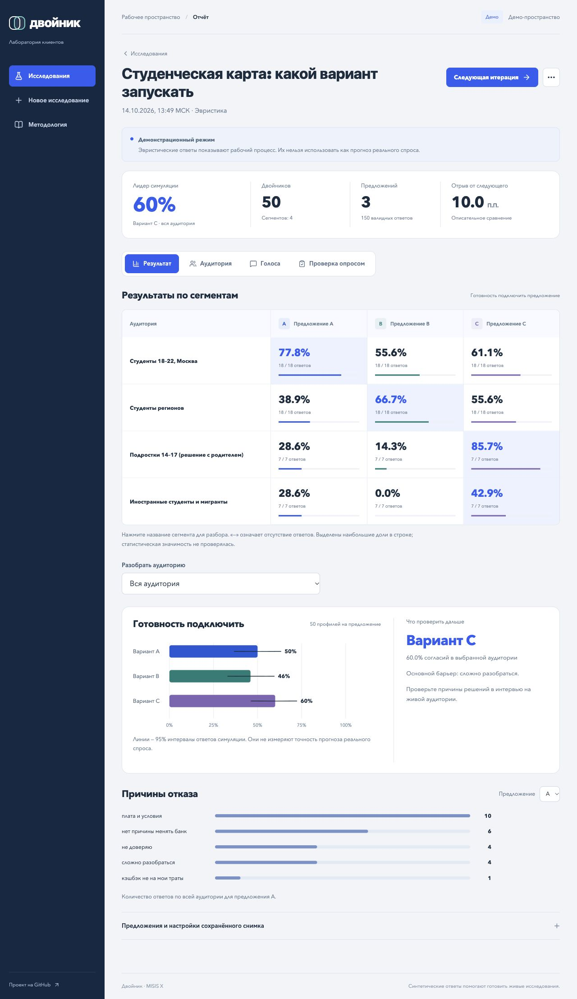
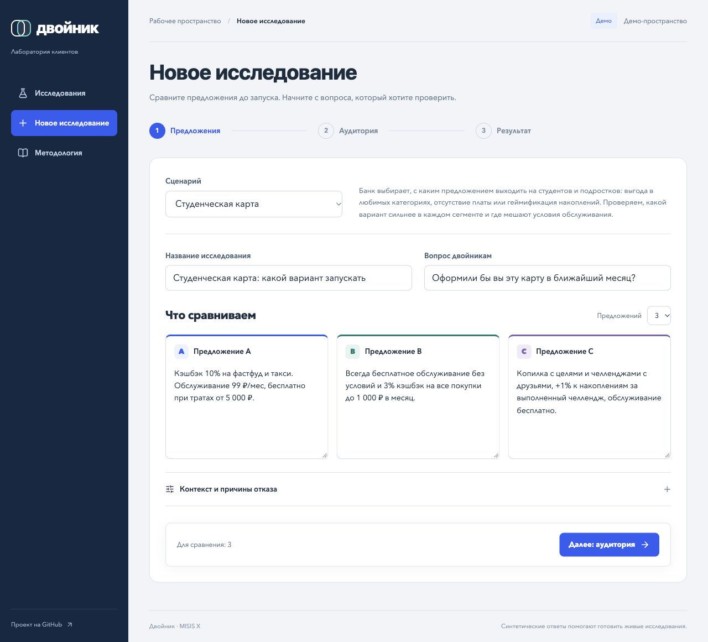
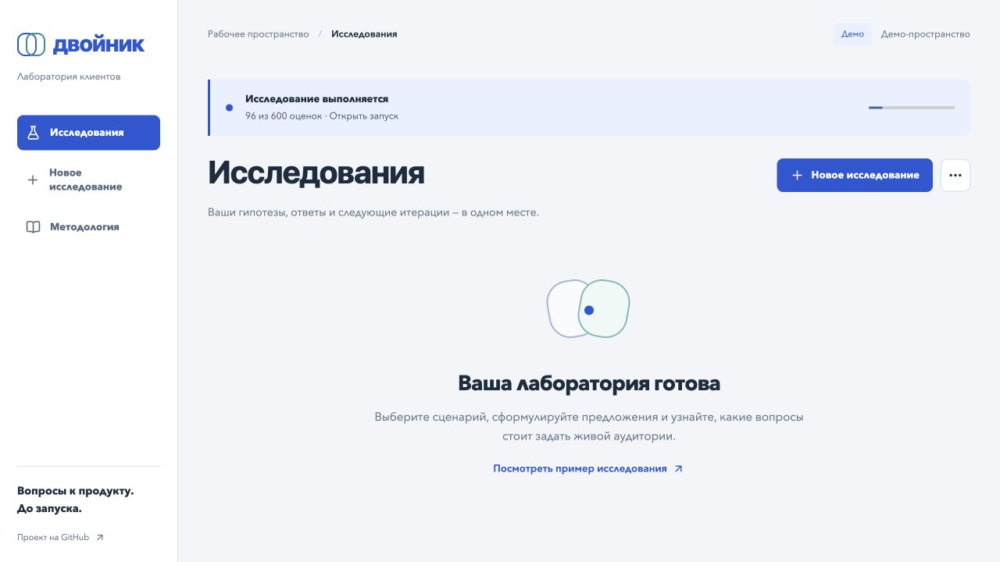

# Двойник

**Синтетическая аудитория для предварительной проверки банковских предложений.**

Продуктовая команда описывает варианты предложения, задаёт аудиторию и сравнивает ответы
цифровых персонажей по сегментам. «Двойник» помогает подготовить интервью, опрос или A/B-тест:
увидеть возможные возражения и выбрать вопросы для живой проверки.

**Работающий локальный MVP** · React + TypeScript · FastAPI + Python · MISIS X

[Маршрут демо](docs/demo.md) · [Пример полного отчёта](examples/senior-deposit.demo.json) · [Запуск и настройка](docs/development.md) · [Архитектура](docs/architecture.md) · [Проверки CI](https://github.com/NikitaMeshDS/dvoinik/actions/workflows/checks.yml)

> Демо основано на правилах и ключевых словах. Его проценты показывают работу продукта,
> а не прогноз реального спроса. Подключение LLM реализовано; точность на живых клиентах
> и калибровка популяции пока не подтверждены.



## Что уже работает

| Возможность | Реализация |
| --- | --- |
| Создание исследования | Путь «предложения → аудитория → результат», семь шаблонов или свой сценарий, 2–5 вариантов |
| Популяция | Семь экспертных сегментов, настройка долей и точное число профилей после округления |
| Симуляция | Демо без внешних запросов и OpenAI-совместимый LLM API; одинаковые профили для вариантов, фактический прогресс |
| Результат | Матрица сегментов, разбор аудитории, интервалы, причины отказа и синтетические объяснения |
| Живая проверка | CSV-предпросмотр, ошибка долей, ранги и лидер; сохранение с защитой от конфликтов двух сессий |
| Архив | Поиск, раскрываемые фильтры с индикатором, сравнение запусков, следующая итерация из снимка, импорт JSON и экспорт JSON/CSV |
| Доступ | Локальные аккаунты, роли и архивы владельцев, HttpOnly-сессии, защита запросов и закрытые скачивания |

Пользователи — продуктовые менеджеры, маркетинг и UX/CJM-исследователи банка.
Первый фокус — **текстовые предложения и коммуникации**. Сокращение времени исследований
и качество ранжирования предстоит измерить в пилоте.

## Запустить демо без аккаунта, API-ключа и GPU

Нужны Git, Python **3.11 или 3.12** и Node.js **24.15+** (ветка24) для сборки интерфейса.
Команды для macOS/Linux:

```bash
git clone https://github.com/NikitaMeshDS/dvoinik.git
cd dvoinik
python3 -m venv .venv
source .venv/bin/activate
pip install -r requirements.txt
npm ci --prefix frontend
npm run build --prefix frontend
DVOINIK_AUTH_MODE=demo python serve.py
```

Откройте **http://127.0.0.1:8501/** на том же компьютере. Вход не требуется;
внешние LLM отключены, используется отдельный демо-архив. В пустом каталоге нажмите
«Посмотреть пример исследования» или создайте своё. Node.js нужен для сборки;
готовый интерфейс и API обслуживает один Python-сервис.

Если порт занят, добавьте `DVOINIK_PORT=8502` перед `python serve.py`.
Это локальное приложение; размещённого публичного веб-демо пока нет.
Рабочий режим с аккаунтами, Windows, LLM и резервный Streamlit описаны в [настройке](docs/development.md).

## Демо за несколько шагов

1. Нажмите «Новое исследование» и выберите «Вклад для пенсионеров».
2. Прочитайте предложения, перейдите к аудитории и запустите 200 двойников.
3. Сравните матрицу и объяснения. Проценты демо не подтверждают поведение людей.
4. Нажмите «Следующая итерация», измените предложение и повторите запуск.
5. В меню каталога выберите сравнение; в меню отчёта скачайте JSON или CSV.

[Полный маршрут](docs/demo.md) включает импорт и загрузку опроса, когда доступны настоящие ответы.
[Сохранённый пример](examples/senior-deposit.demo.json) не содержит живой проверки.



В каталоге видны вопрос, аудитория и доли согласий по всем предложениям.


Скриншоты получены на демонстрационных данных; загруженный в браузерной проверке опрос синтетический.

## Для разработки

Сервер разделён на схемы запросов, сервисы приложения, защиту доступа и группы маршрутов.
React разделяет время жизни сессии, загрузку данных и панели отчёта. Стили сгруппированы по функциям.
[Границы модулей и поток данных](docs/architecture.md) описывают, где добавлять новые возможности.


## Что ещё предстоит подтвердить

- **Поведение людей:** синтетическое «да» не равно фактическому оформлению продукта.
- **Калибровку:** доли и характеристики сегментов сейчас основаны на экспертных предположениях.
- **Качество:** независимое сравнение с живыми респондентами и прошлыми запусками пока не проведено.
- **Экономику:** сроки, стоимость LLM и экономия времени зависят от сценария и инфраструктуры.
- **Банковское внедрение:** корпоративный SSO и сетевое развёртывание в контуре — следующие этапы.

Тестирование экранов по скриншотам и последовательных действий клиента пока не реализовано.
95% интервалы описывают ответы симуляции и не измеряют точность прогнозирования людей.
Тесты проверяют код и протоколы на демо и изолированном HTTP-транспорте; реальную модель они не оценивают.

## Следующий этап

Интервью с продуктовыми командами, проверяемые источники характеристик и первая разведочная
проверка на опросе 30+ человек. Затем — независимое сравнение с простым LLM-подходом и ретро-тест.
Целевой партнёр — продуктовая команда ВТБ; согласованный пилот и бизнес-результаты не заявляются.

## Команда и материалы

- **Никита Мещеряков** — ML/LLM, движок и сервис.
- **Юлия Соколова** — Product Manager, исследования пользователей и подготовка пилота.

Академия Финтеха 2026, трек «Финтех без границ».
[Примеры данных](examples/README.md) · [Ранний снимок v0.1.0 на Streamlit](https://github.com/NikitaMeshDS/dvoinik/releases/tag/v0.1.0)


### Управление запусками

Во время симуляции можно продолжать работу в других разделах: панель активного запуска возвращает к прогрессу и восстанавливается после обновления браузера. Готовый результат появляется в архиве, сохраняя текущую страницу. Кнопка «Остановить» отменяет задачу в очереди или завершает работающий запуск после уже отправленного запроса; неполный отчёт не сохраняется. Временный сбой опроса не подменяет прогресс ошибочным статусом запуска.



Очередь работает в одном процессе: перезапуск сервера прерывает незавершённые исследования, их нужно запускать заново. Готовые снимки хранятся в SQLite. Скриншот снят на отдельном демостенде; показатели не подтверждают точность банковского прогноза.
