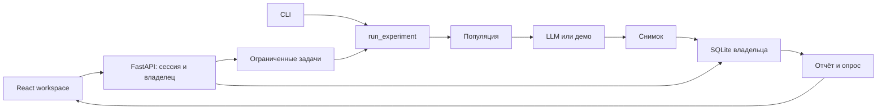

# Архитектура Двойника

Основной интерфейс — React + TypeScript (`frontend/`), сервер — FastAPI (`dvoinik/api.py`).
Собранные статические ресурсы, `/api` и закрытые скачивания обслуживаются одним origin на 127.0.0.1.
`python serve.py --ui streamlit` запускает прежний интерфейс для резервного использования.
CLI и расчёты продолжают работать на существующем Python-движке.

## Границы модулей

- `frontend/src/App.tsx` и `app/useSession.ts`: вход, отзыв доступа и время жизни сессии. `Workspace` монтируется с ключом текущей cookie-сессии; новый аккаунт получает новые состояния компонентов.
- `app/Workspace.tsx`: связывает сценарии и действия; `WorkspaceShell.tsx` отвечает за навигацию и оформление.
- `app/useArchive.ts`, `useRecord.ts`, `useJob.ts`, `useCatalog.ts`, `useDrafts.ts`: загрузка, восстановление несохранённых результатов, опрос прогресса и черновики. Состояния загрузки и ошибок явные, повтор доступен без перезагрузки приложения.
- `shared/requests.ts`: отмена запросов и защита от запоздавшего ответа при новой загрузке или сохранении. `api.ts` отдельно контролирует epoch авторизации и CSRF для всех запросов.
- `features/reports/`: отдельные панели результата, аудитории, голосов, опроса и графика; `useInsights.ts` загружает серверную аналитику. Панель опроса остаётся смонтированной при смене вкладки.
- `features/research/ResponsePreview.tsx`: мини-графики сохранённых долей в каталоге, общая шкала0–100%, пропуски обозначены «—».
- `draft.ts`, `types.ts` и `components.tsx`: общие контракты, копирование черновиков и UI-примитивы. `styles/` хранит стили по функциям; `style.css` задаёт порядок каскада, адаптация применяется последней.
- `dvoinik/api.py`: совместимая фабрика приложения и сборка модулей, без расчётов исследований.
- `dvoinik/http/models.py`: строгие схемы запросов; `runtime.py`: сервисы текущего приложения, временные снимки, опросы, сравнение и подготовка экспорта.
- `dvoinik/http/security.py`: cookie/CSRF, проверка origin, обработка ошибок и заголовки защиты; `static.py`: отдача собранного интерфейса.
- `dvoinik/http/routers/`: группы доступа, исследований, опросов, скачивания и администрирования. Маршруты получают runtime из текущего запроса; фабрики не используют общие кэши или секреты.
- `dvoinik/jobs.py`: два рабочих потока, очередь, фактический прогресс и восстановление записи.
- `runs.py`: единый запуск UI/CLI, строгие параметры и guard доступа.
- `population.py`, `engine.py`: точное распределение профилей, асинхронные оценки и агрегация.
- `insights.py`, `reporting.py`, `comparison.py`, `validate.py`: сегментные интервалы, экспорт, сравнение и опрос.
- `experiments.py`, `storage.py`, `auth.py`: проверка снимков, SQLite, неизменяемость, CAS и доступ.
- `workspace.py` и модули `_ui`: сохранение прежнего Streamlit-пути; новый HTTP UI не импортирует Streamlit.

## Запуск и результаты

`RunSettings` проверяет размер 1–10000, seed 0–999999, параллельность 1–64 и булев mock.
Сценарий нормализуется в отдельную копию; правки черновика не меняют готовый снимок.
`normalize_population` и `allocate_population` используются и предпросмотром API, и генератором:
показанные числа профилей соответствуют запуску. Положительная доля может округлиться до нуля.

Задачи ограничены двумя потоками и восемью местами ожидания; у владельца один активный запуск.
ID задачи привязан к создавшей сессии, а не только к владельцу. Guard проверяется до запуска,
при каждом обновлении прогресса, перед возвратом результата и записью в архив.
Статус прогресса не продлевает время бездействия. Отзыв сессии закрывает результат и скачивания.

Готовый результат при ошибке записи остаётся в памяти для той же сессии: его можно скачать
или повторить сохранение. Такие результаты не вытесняются активными сессиями без объяснения;
при заполнении ограниченного буфера новые запуски отклоняются.
`/api/recovery` восстанавливает их предупреждения и действия после обновления страницы,
пока действует та же cookie-сессия и работает процесс сервера.
Остановка отменяет очередь и прерывает рабочие задачи при следующей проверке guard;
уже отправленный запрос модели завершается в пределах настроенных таймаутов.
Временные буферы теряются при перезапуске, записанные снимки остаются в SQLite.

## Представление и опрос

`/api/insights` использует существующие `segment_report`, `summarize` и `quality_status`.
Фильтр меняет график и реплики, но не снимок и экспорт. Нулевое число согласий при валидных
ответах — 0%; отсутствие ответов — неопределённая доля. Все лидеры при ничьей сохраняются.
Причины отказа старого формата агрегированы по всей аудитории и не присваиваются сегменту.

CSV-предпросмотр вычисляется сервером и не записывается автоматически. При сохранении
`ExperimentStore.save(..., expected_validation=...)` сравнивает предыдущую проверку в транзакции.
Устаревшая сессия получает 409; её серверный предпросмотр остаётся доступен для защищённого
экспорта полного JSON. Проценты и метрики клиента не принимаются как доказанные результаты.
Каждый предпросмотр имеет собственный `preview_id`; экспорт из вкладки получает именно
показанный в ней снимок, даже если другая вкладка загрузила иной опрос. Сохранение опроса
также обновляет состояние задачи, если её исходный результат ещё не был записан.

## Сессии и HTTP

Существующие `AuthStore` и архивы используют прежние пути и владельцев. Cookie HttpOnly,
SameSite Strict; токен не передаётся в JSON, URL или localStorage. CSRF-токен используется
в памяти клиента, связан с серверной сессией и требуется для записывающих запросов.
Origin/Fetch Metadata ограничивают обращения одним origin; Host разрешает только localhost/127.0.0.1.
Пароли остаются Argon2id; сессия имеет 30 минут бездействия и 8 часов абсолютного срока.

Роль администратора управляет доступом, но не открывает чужие исследования. Неизвестный и
чужой ID получают одинаковый 404. Logout сначала отзывает сессию и ссылки, затем удаляет cookie;
при ошибке интерфейс блокирует рабочее пространство до успешного повтора. Выход и 401 очищают
клиентские черновики, кэш и незавершённые UI-действия; поздний ответ прежнего аккаунта отбрасывается.

Одноразовые экспорты живут 15 минут, требуют cookie создавшей сессии и проверяют её срок.
HEAD не погашает файл; GET погашает. Ответы no-store, секретные URL не пишутся в access log.
CSP ограничивает скрипты локальными ресурсами; встраивание в чужие frames запрещено.
Сетевой банковский доступ, HTTPS/SSO и устойчивый внешний worker — отдельные этапы.

## Проверки

Python: `python -m pytest -q`, `ruff check .`, `ruff format --check .`.
Frontend: `npm test --prefix frontend`, `npm run build --prefix frontend`, `npm run format --prefix frontend`.

Проверяются существующие доменные контракты, UI Streamlit, HTTP-сессии/CSRF/изоляция,
отзыв доступа при запуске, очередь/повтор записи, закрытый экспорт и конфликт опросов.
Frontend-проверки защищают черновики, отбрасывание ответов прежнего аккаунта и новой загрузки, а также отмену старого чтения после сохранения.
Browser QA проверяет реальные переходы, файлы, клавиатуру и 390 px.
Эти проверки не подтверждают точность реальной LLM или бизнес-результаты пилота.

## Управление длительными запусками

`Jobs.active(token)` возвращает queued/running/cancelling задачи исходной cookie-сессии. Опрос GET `/api/runs` и GET `/api/runs/{id}` не обновляет таймер бездействия. POST `/api/runs/{id}/cancel` использует обычные проверки CSRF и доступа; отмена идемпотентна и не удаляет завершённый снимок.

В очереди отменяется Future. Работающий запуск сначала получает `cancelling`: уже отправленный запрос к модели может завершиться, но guard запрещает новые оценки, прогресс и сохранение неполного отчёта. Слот освобождается только при выходе работника, после чего статус становится `cancelled`. Остановка процесса сохраняет прежний статус `failed` для прерванных задач.

React `useJob` отслеживает активный запуск во всём рабочем пространстве, отдельно от открытого маршрута. Завершение в фоне обновляет архив; только страница соответствующего запуска переходит к отчёту. Наблюдаемые запуски проверяются независимо от исторического отчёта/задачи. Успешный ответ на остановку применяется сразу и инвалидирует предыдущие чтения. Временная ошибка связи сохраняет последний подтверждённый прогресс; отсутствие задачи после перезапуска убирает устаревшую панель.

Очередь остаётся в памяти одного процесса. После перезапуска сервера незавершённую работу необходимо запустить заново; автоматического возобновления LLM-запросов нет. Сохранённые снимки остаются в SQLite. Авторизация и исходные аккаунты не меняются этой итерацией.

## Навигация и визуальный слой

`features/research/ResearchFilters.tsx` отделяет поиск и раскрываемые фильтры от списка исследований. Их значения и раскрытие принадлежат `LibraryState` рабочего пространства, поэтому сохраняются при переходах к отчёту и обратно. Смена условий сбрасывает страницу выдачи, само раскрытие фильтров страницу не меняет. Пустой результат предлагает сброс; после исчезновения кнопки очистки фокус возвращается к устойчивому полю или переключателю.

`WorkspaceShell` сбрасывает прокрутку и фокусирует основной контент при изменении маршрута. `Composer` аналогично переключает фокус на именованный этап при переходе между предложениями и аудиторией. Обновление полей или результатов на том же экране фокус не перехватывает.

Палитра и основные размеры заданы в `styles/foundation.css`, остальные стили распределены по экранным модулям. Тёмная навигация, светлые рабочие поверхности и цвета A–E отделяют действия от результатов. На 390 px и 1024 px интерфейс проверен в браузере; таблицы отчётов сохраняют собственную горизонтальную прокрутку.
