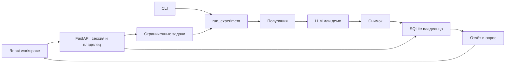

# Архитектура Двойника

Основной интерфейс — React + TypeScript (`frontend/`), сервер — FastAPI (`dvoinik/api.py`).
Собранные статические ресурсы, `/api` и закрытые скачивания обслуживаются одним origin на 127.0.0.1.
`python serve.py --ui streamlit` запускает прежний интерфейс для резервного использования.
CLI и расчёты продолжают работать на существующем Python-движке.

## Границы модулей

- `frontend/src/App.tsx`: рабочее пространство, маршруты hash, владелец черновиков и переходы.
- `frontend/src/api.ts`: same-origin запросы, CSRF, ошибки и отклонение ответов прежней сессии.
- `frontend/src/draft.ts`: отдельные копии настроек и сохранение скрытых D/E.
- `Composer`, `Library`, `Report`, `Compare`, `Account`, `Methodology`: страницы и пользовательские действия.
- `dvoinik/api.py`: HTTP-контракты, сессия, проверка владельца, preview/save и статический интерфейс.
- `dvoinik/jobs.py`: два рабочих потока, очередь, фактический прогресс и восстановление записи.
- `runs.py`: единый запуск UI/CLI, строгие параметры и guard доступа.
- `population.py`, `engine.py`: точное распределение профилей, асинхронные оценки и агрегация.
- `insights.py`, `reporting.py`, `comparison.py`, `validate.py`: сегментные интервалы, экспорт, сравнение и опрос.
- `experiments.py`, `storage.py`, `auth.py`: проверка снимков, SQLite, неизменяемость, CAS и доступ.
- `workspace.py` и модули `_ui`: сохранение прежнего Streamlit-пути; новый HTTP UI не импортирует Streamlit.

## Запуск и результаты

`RunSettings` проверяет размер 1–10000, seed 0–999999, параллельность 1–64 и булев mock.
Сценарий нормализуется в отдельную копию; правки черновика не меняют готовый снимок.
`normalize_population` и `allocate_population` используются и предпросмотром API, и генератором:
показанные числа профилей соответствуют запуску. Положительная доля может округлиться до нуля.

Задачи ограничены двумя потоками и восемью местами ожидания; у владельца один активный запуск.
ID задачи привязан к создавшей сессии, а не только к владельцу. Guard проверяется до запуска,
при каждом обновлении прогресса, перед возвратом результата и записью в архив.
Статус прогресса не продлевает время бездействия. Отзыв сессии закрывает результат и скачивания.

Готовый результат при ошибке записи остаётся в памяти для той же сессии: его можно скачать
или повторить сохранение. Такие результаты не вытесняются активными сессиями без объяснения;
при заполнении ограниченного буфера новые запуски отклоняются. Перезапуск процесса прерывает
временные задачи и буферы; уже записанные снимки остаются в SQLite.

## Представление и опрос

`/api/insights` использует существующие `segment_report`, `summarize` и `quality_status`.
Фильтр меняет график и реплики, но не снимок и экспорт. Нулевое число согласий при валидных
ответах — 0%; отсутствие ответов — неопределённая доля. Все лидеры при ничьей сохраняются.
Причины отказа старого формата агрегированы по всей аудитории и не присваиваются сегменту.

CSV-предпросмотр вычисляется сервером и не записывается автоматически. При сохранении
`ExperimentStore.save(..., expected_validation=...)` сравнивает предыдущую проверку в транзакции.
Устаревшая сессия получает 409; её серверный предпросмотр остаётся доступен для защищённого
экспорта полного JSON. Проценты и метрики клиента не принимаются как доказанные результаты.

## Сессии и HTTP

Существующие `AuthStore` и архивы используют прежние пути и владельцев. Cookie HttpOnly,
SameSite Strict; токен не передаётся в JSON, URL или localStorage. CSRF-токен используется
в памяти клиента, связан с серверной сессией и требуется для записывающих запросов.
Origin/Fetch Metadata ограничивают обращения одним origin; Host разрешает только localhost/127.0.0.1.
Пароли остаются Argon2id; сессия имеет 30 минут бездействия и 8 часов абсолютного срока.

Роль администратора управляет доступом, но не открывает чужие исследования. Неизвестный и
чужой ID получают одинаковый 404. Logout сначала отзывает сессию и ссылки, затем удаляет cookie;
при ошибке интерфейс блокирует рабочее пространство до успешного повтора. Выход и 401 очищают
клиентские черновики, кэш и незавершённые UI-действия; поздний ответ прежнего аккаунта отбрасывается.

Одноразовые экспорты живут 15 минут, требуют cookie создавшей сессии и проверяют её срок.
HEAD не погашает файл; GET погашает. Ответы no-store, секретные URL не пишутся в access log.
CSP ограничивает скрипты локальными ресурсами; встраивание в чужие frames запрещено.
Сетевой банковский доступ, HTTPS/SSO и устойчивый внешний worker — отдельные этапы.

## Проверки

Python: `python -m pytest -q`, `ruff check .`, `ruff format --check .`.
Frontend: `npm test --prefix frontend`, `npm run build --prefix frontend`, `npm run format --prefix frontend`.

Проверяются существующие доменные контракты, UI Streamlit, HTTP-сессии/CSRF/изоляция,
отзыв доступа при запуске, очередь/повтор записи, закрытый экспорт и конфликт опросов.
Frontend-проверки защищают черновики и отбрасывание ответов прежнего аккаунта.
Browser QA проверяет реальные переходы, файлы, клавиатуру и 390 px.
Эти проверки не подтверждают точность реальной LLM или бизнес-результаты пилота.
