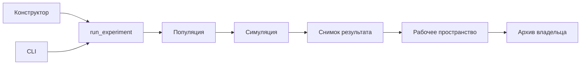

# Архитектура Двойника

`app.py` вызывает `application.main()`. Оболочка проверяет вход до загрузки архива, обновляет
рабочее пространство и выбирает страницу. Модули с суффиксом `_ui` и `ui.py` отвечают за
виджеты и сообщения; расчёты и запись данных находятся в отдельных модулях.

## Запуск исследования

UI и CLI используют `runs.run_experiment(key, scenario, RunSettings(...))`.
`RunSettings` проверяет целые значения размера аудитории (1–10000), seed (0–999999),
параллельности (1–64) и булев режим демо. Конструктор предлагает аудитории 50–1000;
импортированные параметры вне этого диапазона сохраняются при повторном использовании.
Сценарий нормализуется в отдельную копию до генерации профилей. Изменения редактора
не меняют уже созданный снимок.

`experiments.normalize_population` одинаково нормализует доли для редактора и запуска;
это сохраняет одинаковое округление даже при дробных остатках.
`population.allocate_population` рассчитывает точные размеры сегментов методом наибольших
остатков. Его используют и предпросмотр аудитории, и генератор профилей: показанные количества
соответствуют запуску. Положительная доля сегмента может округлиться до нуля при малой аудитории;
интерфейс предупреждает об этом.

UI передаёт `guard` действующей сессии: доступ проверяется перед симуляцией, при обновлении
прогресса и перед возвращением готового снимка. Отзыв доступа прерывает запуск. CLI — доверенный
локальный инструмент сервера, работающий с отдельным выходным файлом; в архив аккаунтов он не пишет.
LLM-ошибки остаются в отчёте отдельно от отказов персонажей.

## Представление результата

`insights.matrix_rows` формирует матрицу из сохранённых количеств ответов, а
`insights.segment_report` рассчитывает доли и интервалы для выбранного сегмента.
Обе функции не меняют снимок. Нулевое число согласий при наличии ответов — 0%;
отсутствие валидных ответов — неопределённая доля. Выделяются все лидеры при ничьей.
В старом формате причины отказа агрегированы по всей аудитории: фильтр сегмента
не присваивает ему эти количества. Подборка сохранённых реплик не представляет
полное распределение причин.

«Использовать как основу» вызывает общий callback `draft_ui.reuse_record`: копирует
настройки именно открытого снимка, сохраняет архив и возвращает конструктор.
Экспорт остаётся полным, независимо от выбранного в отчёте сегмента.

## Сохранение и восстановление

`Workspace` получает mapping состояния сессии и уже ограниченный владельцем `ExperimentStore`.
Он не зависит от Streamlit. `persist` проверяет переносимый JSON и возвращает `WriteResult`:
успешный снимок либо локальную версию с объяснением ошибки сохранения.

- `history` — видимые снимки; `pending_records` — версии, которые не записаны на диск.
- `pending_validation_bases` хранит прежнюю серверную версию опроса для проверки конфликта.
  Локальный предпросмотр не продвигает эту базу до успешного commit.
- `refresh` повторяет независимые записи. Конфликт одной записи не останавливает остальные;
  локальная версия остаётся в очереди и видимом отчёте, серверная версия сохраняется.
- После повторов архив перечитывается и объединяется с локальными ожидающими версиями.
- Истёкший доступ прерывает операции и передаётся оболочке; это не обычная ошибка диска,
  которую можно перенести на следующую учётную запись.

Непригодный JSON не добавляется в очередь. Исходный снимок неизменяем; дополнение опроса
использует сравнение прежней версии, реализованное в `storage.py`, внутри транзакции.

## Настройки и доступ

`settings.py` — общий источник режима доступа, абсолютного пути к SQLite и идентификатора
модели для снимков/проверки изменения настроек. UI и CLI администрирования не импортируют launcher.
`serve.py` отвечает только за жизненный цикл двух локальных сервисов.

`AuthStore.workspace(token)` определяет владельца и guard на сервере. Роль администратора
не открывает чужие исследования. Выход очищает сессионные данные после успешного отзыва доступа;
пока отзыв не записан, вход другой учёткой закрыт. Выдача CSV/JSON остаётся одноразовой,
с проверкой связанной сессии; отчёты не регистрируются в публичном media-route.

## Проверки изменений

Запустите `python -m pytest -q`, `ruff check .` и `ruff format --check .`.
Основные контракты проверяют тесты UI/CLI, `test_runs.py`, тесты хранения, авторизации и HTTP-выдачи.
При изменении сохранения проверяйте конфликты двух сессий, повторные ошибки диска и отзыв доступа.
При изменении редактора — скрытые варианты D/E, переходы между страницами и неизменяемость отчёта.
Тесты используют демо либо изолированный HTTP-транспорт; они не подтверждают качество реальной LLM.
